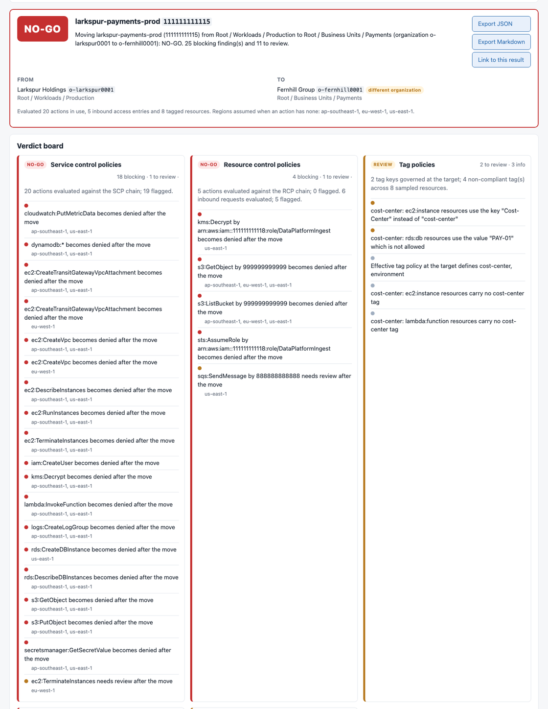

# orgshift

A go / no-go simulator for moving AWS accounts between organizational units
and between organizations. It reads snapshots of the source and destination
setup, works out what changes for the account, and gives a **GO / REVIEW /
NO-GO** verdict with every blocker explained, the networking dependencies
called out, and an explicit account of what the snapshots did and did not
cover.



## What it does

Moving an account to another OU changes which service control policies,
resource control policies, tag policies and backup policies apply to it.
Moving it to another organization changes more: organization-scoped RAM
shares (transit gateways, subnets, Resolver rules, IPAM pools, prefix
lists), delegated administration, the organization trail, Config aggregation
and service-managed StackSets stop applying. orgshift simulates the move
offline and reports:

- **Collection coverage**: every snapshot records, per domain, what the
  collector could read (observed, empty) and what it could not (skipped,
  unsupported, partial, access denied, error, or no record at all). The
  verdict names the domains the move depends on; an incomplete required
  domain turns the check that depends on it into a REVIEW with a
  "collect the missing evidence" step, and a GO is never issued on
  incomplete evidence. An empty list in a snapshot therefore means "nothing
  exists" only when the collector says it looked.
- **SCPs and RCPs**: the effective policy at the source path and at the
  target path, root to account, with allow lists intersected and denies
  accumulated. Every action the account uses is evaluated against both, per
  region, and each action that is allowed today but denied after the move is
  reported with the policy and statement that cause it. Conditions on
  `aws:RequestedRegion`, `aws:PrincipalOrgID`, `aws:PrincipalAccount`,
  `aws:PrincipalArn`, `aws:PrincipalTag/*`, `aws:ResourceAccount` and
  `aws:PrincipalIsAWSService` are evaluated; anything the tool cannot decide
  offline comes back as REVIEW rather than a guess. A policy document that
  does not parse is rejected on load with the statement at fault, and never
  turns into an implicit allow. RCPs follow a versioned applicability model
  of the services AWS lists (62 on 2026-11-01); actions on other services
  are reported as not evaluated, and a resource owned by another account is
  checked against that account's RCPs with the caller's organization
  changed.
- **Inbound access**: principals outside the account that call into it are
  checked against the destination's resource control policies.
- **Tag policies**: the effective tag policy at the target, merged with the
  `@@assign` / `@@append` / `@@remove` operators, and the sampled resources
  whose keys or values would be non-compliant, with the enforced resource
  types.
- **Cross-organization moves**: lost RAM shares with the documented
  behaviour per resource type (transit gateway attachments and shared-subnet
  resources keep working, Resolver rules stop answering, other types are
  reported as unverified), delegated administration and the four-day rule
  for created accounts as blockers, the organization trail, Config
  aggregation, StackSets, trusted access gaps, the standalone-account
  prerequisites, and the account tags and management role AWS deletes or
  keeps.
- **Staged migrations**: a scenario overlay (`orgshift stages`) describes
  the migration as proposed states across five layers kept separate
  (membership, OU placement, Control Tower governance, network, workload),
  with proposed OUs, policies and shares that exist only in the overlay.
  Every transition is evaluated with the full verdict board, the stage's own
  findings cover the standalone window, what a proposed OU inherits,
  enrollment prerequisites and management-account constraints from the
  official transfer procedure, and the transfer strategy is compared with
  creating destination accounts and migrating the workloads. See
  [docs/stages.md](docs/stages.md).
- **Impact categories**: every finding says whether it is a known
  restriction, an impact on a declared or observed operation, a potential
  impact needing context, an unsupported evaluation or missing evidence,
  with a confidence; user-declared critical operations are evaluated next
  to the observed usage and marked as declared.
- **Verdict**: NO-GO for a known blocking condition (an action in use
  becomes denied, a share whose loss is documented to stop traffic or a
  declared operation, a delegated administrator, a shared Control Tower
  account); REVIEW for anything unevaluable, for incomplete required
  coverage or for a decision to make; GO within the explicitly assessed
  scope otherwise, which is never a guarantee of zero downtime or of
  compatibility with everything the account does. Every finding carries its
  evidence and the documentation page its claim rests on, and the result
  exports as JSON and Markdown with the coverage matrix and the versions of
  the models used.
- **Whole-OU moves**: pick an OU instead of an account and every nested OU
  and account is evaluated at its new position. The OU verdict is the worst
  account verdict, with a per-account rollup table (blocking and review
  counts, the blocking findings) and the full board for each account.
  Inside one organization the OU's attachments travel with it; across
  organizations the OU tree cannot move and is reported as something to
  recreate, with the accounts evaluated under recreated OUs that carry only
  the AWS managed defaults.
- **Control Tower**: when a snapshot carries a landing zone, the verdict
  board gets a Control Tower check. Enrolment is read from the child enabled
  baselines, not inferred from the OU (the inference is used only when the
  list was never collected, and the finding says so). Leaving a registered
  OU or the organization is flagged as unenrolling the account, with the
  guardrail SCPs and detective controls that stop; entering a registered OU
  lists what enrolment needs; moving between registered OUs goes through
  Account Factory unless the landing zone has auto-enrollment on, in which
  case the findings describe what Control Tower does by itself; moving the
  audit or log archive account is a NO-GO. The `aws-guardrails-*` SCPs are
  labelled as Control Tower managed in the chain, diff and tree views.
- **Migration runbook**: every result comes with an ordered checklist
  generated from the findings. First the evidence to collect; then, before
  the move, each denied action grouped by the SCP or RCP statement that
  causes it, tags to fix, delegated administration to hand over, Control
  Tower unenrolment, the `LeaveOrganization` deny to lift, the standalone
  prerequisites; then what does not travel and has to be re-created: RAM
  shares re-shared with the account directly, permission sets prepared in
  the target Identity Center, StackSets, trusted access; then the move
  itself, the checks afterwards and a rollback built from the source chain.
  The UI renders it as a checklist that remembers ticks in the browser; it
  exports as Markdown and JSON. It is a document: every command is for you
  to review and run by hand, and orgshift still never writes to AWS. The
  phases and the JSON shape are in [docs/runbook.md](docs/runbook.md).
- **IAM Identity Center**: when a snapshot carries an Identity Center
  instance, a cross-organization move lists every account assignment on the
  account (users and groups per permission set), says whether the target
  instance has a permission set of the same name and how its settings
  differ, and reports the `AWSReservedSSO_*` roles that go with the
  instance's control over the account, including roles still provisioned
  without an assignment. All of it is REVIEW with the assignment and
  permission set as evidence; inside one organization the check is a quiet
  GO.

What the evaluator believes about AWS, and which documentation page each
belief was checked against, is in
[docs/aws-behaviour.md](docs/aws-behaviour.md).

## Who it is for

A migration assessment and rehearsal tool for AWS organizations, built to be
safe to point at a real one: the collector only ever calls `List`, `Describe`
and `Get` operations behind an explicit allowlist that the tests enforce,
records what it could not read instead of pretending, and the simulator
itself never needs AWS access. Outputs are machine-readable (JSON with a
schema version), reproducible from the snapshots, and explicit about
uncertainty.

## Stack

Go 1.24, a single binary. `aws-sdk-go-v2` for the read-only collector,
`html/template` and HTMX for the UI (static files embedded with `embed`, no
Node build step), `go test` with golden-file tests on fixture organizations
and fuzz targets for the policy parser, the matcher, the snapshot loader and
the evaluator, `go vet` and `staticcheck`.

## Quick start with the fixtures

```sh
go build -o orgshift ./cmd/orgshift

# two fictional organizations with problems planted in them, plus the first
# one as a collector with narrower permissions would have recorded it
./orgshift fixtures --out fixtures

# move the payments account from Larkspur Holdings to Fernhill Group
./orgshift simulate \
  --from fixtures/larkspur-holdings.json \
  --to fixtures/fernhill-group.json \
  --account 111111111115 --target-ou ou-fern-pay1

# the same move inside one organization, as Markdown
./orgshift simulate --from fixtures/larkspur-holdings.json \
  --account 111111111117 --target-ou ou-lark-prod --format markdown

# a GO move, and the same move on the partially collected snapshot: REVIEW,
# because the shares, Control Tower and StackSets were never read
./orgshift simulate --from fixtures/larkspur-holdings.json \
  --account 111111111116 --target-ou ou-lark-prod
./orgshift simulate --from fixtures/larkspur-holdings-partial.json \
  --account 111111111116 --target-ou ou-lark-prod

# Fernhill runs Control Tower: take an enrolled account out of its
# registered OU and see what unenrolling it means
./orgshift simulate --from fixtures/fernhill-group.json \
  --account 222222222225 --target-ou ou-fern-sand

# the data platform account into Fernhill Retail: three Identity Center
# assignments and three AWSReservedSSO_* roles go away with it
./orgshift simulate \
  --from fixtures/larkspur-holdings.json \
  --to fixtures/fernhill-group.json \
  --account 111111111118 --target-ou ou-fern-ret

# move the whole Workloads OU (two nested OUs, three accounts) into
# Fernhill's Business Units; --target-ou is the new parent
./orgshift simulate \
  --from fixtures/larkspur-holdings.json \
  --to fixtures/fernhill-group.json \
  --ou ou-lark-work --target-ou ou-fern-bu

# the migration runbook for the payments move, as a Markdown checklist
./orgshift simulate \
  --from fixtures/larkspur-holdings.json \
  --to fixtures/fernhill-group.json \
  --account 111111111115 --target-ou ou-fern-pay1 \
  --format runbook --out payments-runbook.md

# the same move as seven proposed stages: prerequisites, entry at the root,
# a transitional Legacy OU, validation, Control Tower enrollment, tightening;
# the scenario overlay names the fixture snapshots next to it
./orgshift stages --scenario fixtures/scenario-payments-to-fernhill.yaml
./orgshift stages --scenario fixtures/scenario-payments-to-fernhill.yaml --format markdown --out payments-stages.md

# a same-organization staged move: the Fernhill sandbox account into a
# proposed Transitional OU, registration and enrollment, then tightening
./orgshift stages --scenario fixtures/scenario-fernhill-sandbox-staged.yaml

# declare operations the account must keep performing on a single move
./orgshift scenario example > plan.yaml
./orgshift simulate --from fixtures/larkspur-holdings.json --to fixtures/fernhill-group.json \
  --account 111111111115 --target-ou ou-fern-pay1 --critical-operations plan.yaml
```

`simulate` exits 0 for GO, 2 for REVIEW and 3 for NO-GO, so it can gate a
pipeline. `--format json|markdown` and `--out` write the full report;
`--format runbook` (Markdown) and `--format runbook-json` write the
migration runbook instead.

### The web UI

```sh
./orgshift serve            # http://127.0.0.1:8080, fixtures preloaded
./orgshift serve --from a.json --to b.json
```

Load two snapshots (or the fixtures), pick the account and the target OU,
and the page shows the verdict board with expandable explanations (a check
whose evidence is incomplete carries an "evidence incomplete" pill), the
collection coverage matrix, the migration runbook as a checklist (ticks are
remembered by the browser, the "Export runbook" button writes it as
Markdown), the two organization trees side by side with the policy chain
highlighted and the account drawn at its future position, the "what changes"
diff of effective policies, and export buttons.

Switch "What moves" to "a whole OU" to move an OU instead: the result opens
with the per-account rollup table, the OU's own findings (what travels with
it, what has to be recreated), the subtree drawn at its new position and the
inherited-policy diff at the OU, followed by a collapsible verdict board per
account.

## Using it on a real organization

The onboarding flow is one configuration file, the IAM roles generated from
it, a preflight and then the collection; [docs/onboarding.md](docs/onboarding.md)
has every option.

1. Describe the access:

   ```sh
   ./orgshift config example > orgshift.yaml     # edit: accounts, profiles or SSO sessions, regions, roles
   ./orgshift config check --config orgshift.yaml
   ```

2. Create the read-only roles. `orgshift iam-templates --config orgshift.yaml
   --out iam/` writes one role per collector responsibility (org management,
   Control Tower, Identity Center, member inspection, network) with its
   trust policy, the account it goes in, the delegated-administrator
   alternative and a justification for every `Resource: "*"`; the
   placeholder version is in [docs/iam](docs/iam/README.md). Every action
   comes from the operation catalog, which classifies each operation
   orgshift calls as a free read, a billable read behind an opt-in, or a
   session operation, and whose tests refuse any write
   ([docs/permissions.md](docs/permissions.md)).

3. Check the permissions before collecting:

   ```sh
   ./orgshift preflight --config orgshift.yaml
   ```

   Every credential is checked with `sts:GetCallerIdentity` against the
   account the configuration names; then the cheapest read of each
   collection domain is tried and reported as available, denied, error or
   unknown, in the coverage matrix layout, with the action and identity to
   grant for every denial. Exit code 0 means ready.

4. Collect a snapshot of each organization:

   ```sh
   ./orgshift collect --config orgshift.yaml --side source --out snapshots/source.json
   ./orgshift collect --config orgshift.yaml --side destination --out snapshots/destination.json
   ```

   The collector refuses to run when a credential belongs to another
   account than configured. Per-item calls run a few at a time, throttling
   is retried with backoff, and a checkpoint next to the output lets a rerun
   restore the completed steps and read only what was denied or cut short.
   Every domain the collector could not read ends up in the snapshot's
   `coverage` block, and the command prints the gaps. Optional data sources
   that cost money (CloudTrail Lake, Config advanced queries) are behind
   opt-ins that are off by default and refused until they are implemented.

5. Tell orgshift what the account does. Add `usage.<account-id>.actions`,
   `inbound_access` and `tagged_resources` to the source snapshot (the format
   is in [docs/snapshot.md](docs/snapshot.md)), or import an IAM last-accessed
   export:

   ```sh
   aws iam generate-service-last-accessed-details --arn arn:aws:iam::111111111115:role/App --granularity ACTION_LEVEL
   aws iam get-service-last-accessed-details --job-id … > last-accessed.json
   ./orgshift simulate --from snapshots/source.json --to snapshots/destination.json \
     --account 111111111115 --target-ou ou-xxxx-yyyy --last-accessed last-accessed.json
   ```

   The snapshot file is never modified; the import is merged in memory for
   that run.

6. Propose the stages. Write a scenario overlay (`orgshift scenario example`,
   [docs/stages.md](docs/stages.md)) with the proposed OUs, policies and
   shares, the critical operations the account must keep performing and the
   stages across the five layers, then evaluate every stage:

   ```sh
   ./orgshift stages --scenario plan.yaml --from snapshots/source.json --to snapshots/destination.json --format markdown --out plan.md
   ```

7. Read the verdicts and the coverage matrix, work through the runbook
   (collect what is missing, fix what it lists before the move, re-create
   what does not travel), collect again, repeat until GO. The runbook's
   commands are for you to run; orgshift only reads.

`snapshots/`, `*.snapshot.json`, `*.checkpoint.json`, `orgshift.yaml` and
`.env` are ignored by git so real data does not end up in the repository.

## Assumptions worth knowing

- Actions in use are assumed to be performed by IAM roles of the account
  unless `principal_arn` says otherwise. This lets the common root-user deny
  be evaluated instead of turning every action into a REVIEW.
- Actions without explicit regions are evaluated in every region the
  account has enabled; global services are evaluated in `us-east-1`.
- An action whose resource names no account is assumed to act on the
  account's own resources; a resource in another account is evaluated
  against that account's RCPs.
- A cross-organization move drops policies attached directly to the account
  and attaches the target's AWS managed defaults, which is what Organizations
  does when an account joins.
- Only SCPs, RCPs and tag policies are evaluated. Backup policies are shown
  in the chain and the diff; comparing them is on the roadmap. The
  governance-policy evaluation is not a replacement for IAM authorization:
  an SCP or RCP allow grants nothing.
- Without a collected `control_tower.enrolled_accounts` list, an account
  whose parent OU is registered with Control Tower is assumed to be
  enrolled, and the finding says so. With the list collected, an account
  that is not on it is not enrolled.
- The `AWSReservedSSO_*` role names end in a random suffix that only IAM in
  the member account knows, so they are reported as patterns
  (`AWSReservedSSO_<permission set>_*`). Permission sets in the two
  instances are matched by name; users and groups are never matched, since
  the identity stores are different directories.
- The lists of RCP-governed services and of RAM behaviours per resource type
  are versioned models checked against the AWS documentation on a date
  recorded in every result; services and behaviours added later are not
  covered until the model is updated.

## Repository layout

```
cmd/orgshift          CLI: fixtures, simulate, stages, scenario, serve, config, iam-templates, preflight, collect
internal/scenario     scenario overlay: stages across five layers, derived states, staged evaluation, strategy comparison
internal/config       onboarding configuration (YAML or JSON): access per side, regions, collection options
internal/awsaccess    credentials from profiles, Identity Center sessions and assume-role chains; identity check
internal/iamtemplates IAM role templates per collector responsibility, generated from the operation catalog
internal/preflight    permission preflight: the cheapest read per domain, reported as a coverage matrix
internal/snapshot     versioned snapshot schema, coverage model, loader, validation
internal/policy       IAM policy parsing and tri-state statement matching (fuzzed)
internal/evaluator    effective policies, RCP and RAM models, coverage requirements, tag policies, cross-org checks, verdict
internal/fixtures     the Larkspur Holdings and Fernhill Group generator, plus the partial collection of Larkspur
internal/runbook      migration runbook built from a result: collect, fix, re-create, move, check, roll back
internal/report       JSON, Markdown and text rendering, runbook Markdown
internal/usage        actions-in-use files and IAM last-accessed import
internal/web          html/template + HTMX UI, embedded static files
internal/collector    read-only AWS collector behind an operation catalog, with bounded concurrency, retries, checkpoints and coverage
docs/                 onboarding, stages, snapshot schema, permissions, IAM templates, runbook, AWS behaviour references, screenshot
```

## Development

```sh
go vet ./... && go run honnef.co/go/tools/cmd/staticcheck@2025.1.1 ./... && go test ./...
go test ./internal/evaluator ./internal/runbook ./internal/report ./internal/scenario -update   # refresh golden files after reviewing a change
go test ./internal/iamtemplates -update                                       # regenerate docs/iam from the operation catalog
go test ./internal/policy -run '^$' -fuzz FuzzParseAndApply -fuzztime 60s      # fuzz the policy parser and matcher
go test ./internal/evaluator -run '^$' -fuzz FuzzEvaluateWithPolicyDocument -fuzztime 60s
```

Development sessions never run `orgshift collect`, the AWS CLI or any SDK
call against a real account; everything is exercised with fixtures and
mocks. See [ROADMAP.md](ROADMAP.md) for the milestone plan and what comes
next.

## License

MIT, see [LICENSE](LICENSE).
